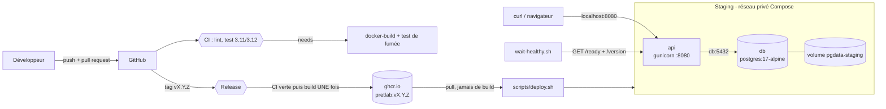

# Fiche d'une page — PrêtLab (projet de fin de module DevOps)

**Étudiant :** _à compléter_ · **Dépôt :** _URL à compléter_ · **Date :** _à compléter_

## Architecture

Le port 5432 de la base **n'est pas publié** : seule l'API la joint, par le nom de service `db`.

## Version mise en service

| Élément | Valeur |
|---|---|
| Version en service à la fin | **v1.0.0** (après retour arrière) — _à confirmer avec_ `curl localhost:8080/version` |
| Version précédemment déployée | v1.1.0 (ajoute `GET /loans/overdue`) |
| Image | `ghcr.io/<propriétaire>/pretlab:v1.0.0`, construite **une seule fois** par le workflow Release |
| Contrôle de santé | `scripts/wait-healthy.sh v1.0.0` → `/ready` répond **et** `/version` affiche `v1.0.0` |
| Empreinte (digest) de l'image | _à copier du résumé de l'exécution Release_ |

## Déroulé du retour arrière (v1.1.0 → v1.0.0)

1. Constat : v1.1.0 en service (`/version` affiche `v1.1.0`) ; décision de revenir à la version précédente.
2. `./scripts/deploy.sh --previous` (équivalent : `./scripts/deploy.sh v1.0.0`). Le script lit la version précédente dans `.deploy-state`, écrit `IMAGE_TAG=v1.0.0` dans `.env.deploy`, tire l'image **déjà publiée** (aucun build) et relance `up -d`.
3. Le script attend `/ready` **et** la version `v1.0.0` (`wait-healthy.sh`), puis affiche `[SUCCES]`.
4. Preuves : `/version` → `v1.0.0` ; `/loans/overdue` → 404 (route absente de v1.0.0) ; données conservées (volume). Durée mesurée : _à compléter avec le `real` de `time`_.

## La chaîne en bref

Git (branches + PR, hooks anti-secrets, commits conventionnés) → `check.sh` (0/1/2) → Dockerfile multi-stage (non root, HEALTHCHECK, labels OCI) → Compose (db healthy, volume, port non publié) → CI (lint, tests, build avec `needs`, rapport en artefact) → tag `vX.Y.Z` → image publiée → `deploy.sh` → retour arrière par tag.
